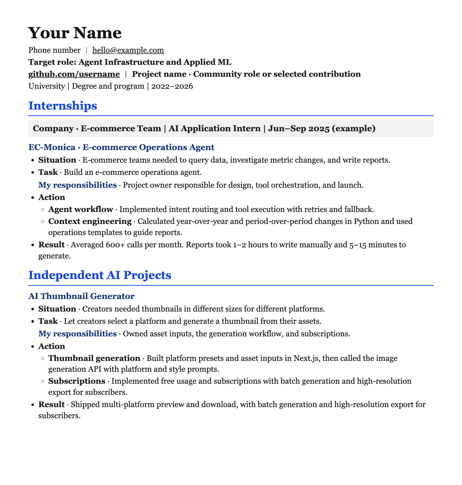

# OfferHunter · Open-source AI Resume Writer and STAR Resume Skill

English | [简体中文](README.md)

[](LICENSE)

**OfferHunter is an open-source AI resume writer and editing skill for Claude, ChatGPT, Codex, Grok, and other AI assistants.** Turn project notes, an existing resume or CV, and a target job description into a focused application. Draft a full resume, reorganize work and internship sections, or rewrite individual bullets using STAR. Write in English, Chinese, or both, with minimalist HTML and LaTeX templates.

- **Tailor the resume to the role.** Use it for LLM and AI agent engineering, machine learning research, model evaluation, AI product management, data, MLOps, inference infrastructure, and solutions engineering. [100 BOSS Zhipin job samples](skills/resume-engineering/references/ai-roles.md)
- **Learn from a real project.** The EC-Monica e-commerce agent example pairs business context and measurable impact with specific engineering contributions. [English STAR case study](skills/resume-engineering/references/workflow.en.md)
- **Edit the whole document.** Reorder sections, shorten low-relevance entries, and foreground evidence of ownership and delivery. [Full resume structure](skills/resume-engineering/references/resume-structure.md)

[Quick start](#quick-start) · [STAR method](#write-with-star) · [HTML template](#html-resume-template) · [FAQ](#faq)

## Quick Start

Clone into your project, then run the install command for your client.

```sh
git clone https://github.com/LofiSu/OfferHunter.git
```

```sh
# Claude Code
mkdir -p .claude/skills && cp -R OfferHunter/skills/resume-engineering .claude/skills/
# Codex
mkdir -p .agents/skills && cp -R OfferHunter/skills/resume-engineering .agents/skills/
# Grok CLI
mkdir -p .grok/skills && cp -R OfferHunter/skills/resume-engineering .grok/skills/
```

Start a new session and ask your agent to use `resume-engineering`.

**ChatGPT, Claude, and Grok on the web** — Attach or paste [SKILL.md](skills/resume-engineering/SKILL.md) with your resume or project notes and, if available, the target job description. For API integrations, see the [OpenAI Skills guide](https://developers.openai.com/api/docs/guides/tools-skills).

## Write with STAR

- **Situation** — Identify the users, the problem, and the constraints.
- **Task** — State the project goal, then name what you owned.
- **Action** — Use short headings for key contributions. Describe what you did, how it worked, and the tradeoffs that mattered.
- **Result** — Attach verified outcomes to the relevant action. Attribute team outcomes to the team. When metrics are unavailable, describe a delivered capability, documented adoption, or a validated finding.

Write each project as four labeled lines in this order: **Situation**, **Task**, **Action**, and **Result**. Keep the lines short for a one-page resume.

Use OfferHunter for research, training, applications, infrastructure, data, evaluation, safety, product, design, governance, and customer-facing deployment. The target role guides which experiences to highlight.

## Example

“Rewrite these two projects for an AI evaluation role. Keep the offline test scope and distinguish my work from the team's results.”

See how an AI thumbnail generator project becomes a copy-ready resume entry. [English STAR workflow and examples](skills/resume-engineering/references/workflow.en.md)

See the [EC-Monica e-commerce operations agent case study](skills/resume-engineering/references/workflow.en.md) for a full STAR breakdown and resume-ready entry.

## Full resumes and LaTeX

Draft a full resume from project notes, reorganize an existing resume, or rewrite one entry. The default structure is a compact header followed by work experience, internships, and independent AI projects. Education, open-source work, and awards appear where relevant. The LaTeX template uses a clean, single-column layout.

[Resume structure](skills/resume-engineering/references/resume-structure.md) · [LaTeX template](skills/resume-engineering/templates/resume.tex)

## HTML Resume Template



This example starts with internships. If you have full-time experience, reuse the employer and project markup to add a Work Experience section above it.

Copy the code into `resume.html`, open it in a browser, and use the print menu to export an A4 PDF.

<details>
<summary>Show and copy the HTML source</summary>

```html
<!doctype html>
<html lang="en">
<head>
  <meta charset="utf-8">
  <meta name="viewport" content="width=device-width, initial-scale=1">
  <title>Your Name</title>
  <style>
    @page { size: A4; margin: 11mm; }
    * { box-sizing: border-box; }
    body {
      max-width: 210mm; margin: 0 auto; padding: 11mm;
      background: #fff; color: #161616;
      font: 10.5pt/1.38 Georgia, "Songti SC", "Noto Serif CJK SC", serif;
    }
    h1 { font-size: 21pt; line-height: 1.15; margin: 0 0 .15em; }
    header p { margin: .12em 0; }
    a { color: inherit; overflow-wrap: anywhere; }
    .profile, .open-source { font-weight: 700; }
    .section-title {
      color: #174add; border-bottom: 1.5px solid #315eed;
      font-size: 15pt; margin: .55em 0 .35em; padding-bottom: .16em;
    }
    .employer {
      background: #f0f1f3; border-radius: 4px;
      margin: .45em 0 .3em; padding: .32em .55em; font-size: 11pt;
    }
    .project-title { color: #193677; margin: .55em 0 .15em; font-size: 11pt; }
    .star { margin: 0; padding-inline-start: 1.25em; }
    .star > li { margin: .16em 0; }
    .star ul { list-style: circle; margin: .1em 0 0; padding-inline-start: 1.25em; }
    .responsibility { margin: .2em 0 .18em; }
    .responsibility strong { color: #193677; }
    .star-action li { margin: .12em 0; }
    @media print {
      body { max-width: none; margin: 0; padding: 0; }
      h2, h3, h4 { break-after: avoid; }
      li { break-inside: avoid; }
      .employer { print-color-adjust: exact; }
    }
  </style>
</head>
<body>
  <header>
    <h1>Your Name</h1>
    <p>Phone number ｜ <a href="mailto:hello@example.com">hello@example.com</a></p>
    <p class="profile">Target role: Agent Infrastructure and Applied ML</p>
    <p class="open-source"><a href="https://github.com/username">github.com/username</a> ｜ Project name · Community role or selected contribution</p>
    <p>University | Degree and program | 2022–2026</p>
  </header>
  <main>
    <section>
      <h2 class="section-title">Internships</h2>
      <h3 class="employer">Company · E-commerce Team | AI Application Intern | Jun–Sep 2025 (example)</h3>
      <article class="resume-project">
        <h4 class="project-title">EC-Monica · E-commerce Operations Agent</h4>
        <ul class="star">
          <li><strong>Situation</strong> · E-commerce teams needed to query data, investigate metric changes, and write reports.</li>
          <li><strong>Task</strong> · Build an e-commerce operations agent.
            <div class="responsibility"><strong>My responsibilities</strong> · Project owner responsible for design, tool orchestration, and launch.</div>
          </li>
          <li class="star-action"><strong>Action</strong>
            <ul>
              <li><strong>Agent workflow</strong> · Implemented intent routing and tool execution with retries and fallback.</li>
              <li><strong>Context engineering</strong> · Calculated year-over-year and period-over-period changes in Python and used operations templates to guide reports.</li>
            </ul>
          </li>
          <li><strong>Result</strong> · Averaged 600+ calls per month. Reports took 1–2 hours to write manually and 5–15 minutes to generate.</li>
        </ul>
      </article>
    </section>

    <section>
      <h2 class="section-title">Independent AI Projects</h2>
      <article class="resume-project">
        <h4 class="project-title">AI Thumbnail Generator</h4>
        <ul class="star">
          <li><strong>Situation</strong> · Creators needed thumbnails in different sizes for different platforms.</li>
          <li><strong>Task</strong> · Let creators select a platform and generate a thumbnail from their assets.
            <div class="responsibility"><strong>My responsibilities</strong> · Owned asset inputs, the generation workflow, and subscriptions.</div>
          </li>
          <li class="star-action"><strong>Action</strong>
            <ul>
              <li><strong>Thumbnail generation</strong> · Built platform presets and asset inputs in Next.js, then called the image generation API with platform and style prompts.</li>
              <li><strong>Subscriptions</strong> · Implemented free usage and subscriptions with batch generation and high-resolution export for subscribers.</li>
            </ul>
          </li>
          <li><strong>Result</strong> · Shipped multi-platform preview and download, with batch generation and high-resolution export for subscribers.</li>
        </ul>
      </article>
    </section>
  </main>
</body>
</html>
```

</details>

## FAQ

### Can I write a full AI resume without a target job description?

Yes. Start with an existing resume or project notes and prioritize entries with clear ownership and outcomes. Once you have a job description, reorder and shorten the draft around the work that role actually does.

### How do I use STAR on a one-page resume?

Write four brief lines per project: Situation, Task, Action, and Result. Attribute team outcomes. A shipped capability, documented adoption, or validated finding can also show impact.

### How do I export a resume to PDF?

Use your browser’s print menu to export the HTML version as A4 PDF. The LaTeX template is intended for XeLaTeX. Both use a single-column layout.

### Where do the job description examples come from?

The index uses public BOSS Zhipin recruiting lists. It records role titles, visible JD keywords, STAR prompts, and source links. See the [job reference](skills/resume-engineering/references/ai-roles.md) for collection dates and coverage.

## Contributing

Share traceable job postings, anonymized resume examples, or template improvements through [GitHub Issues](https://github.com/LofiSu/OfferHunter/issues). If OfferHunter helped you turn a project into a stronger resume entry, consider starring the repository.

## License

[MIT](LICENSE)
