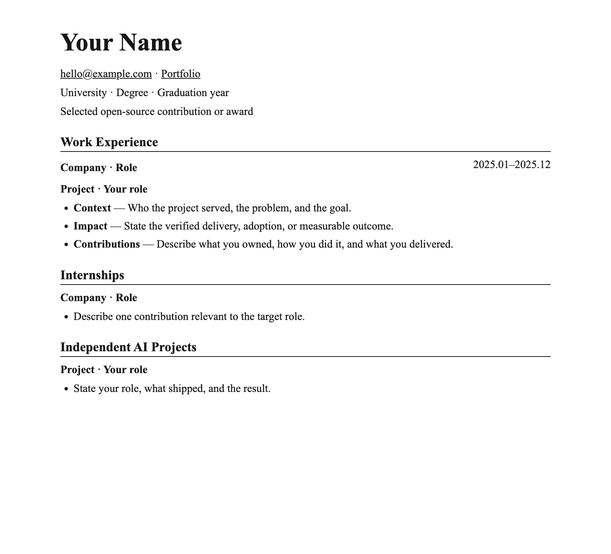

# OfferHunter · Open-source AI Resume Writer and STAR Resume Skill

English | [简体中文](README.md)

[](LICENSE)

**OfferHunter is an open-source AI resume writer and editing skill for Codex.** Turn project notes, an existing resume or CV, and a target job description into a focused application. Draft a full resume, reorganize work and internship sections, or rewrite individual bullets using STAR. Write in English, Chinese, or both, with minimalist HTML and LaTeX templates.

- **Tailor the resume to the role.** Use it for LLM and AI agent engineering, machine learning research, model evaluation, AI product management, data, MLOps, inference infrastructure, and solutions engineering. [100 BOSS Zhipin job samples](skills/resume-engineering/references/ai-roles.md)
- **Learn from a real project.** The EC-Monica e-commerce agent example pairs business context and measurable impact with specific engineering contributions. [English STAR case study](skills/resume-engineering/references/workflow.en.md)
- **Edit the whole document.** Reorder sections, shorten low-relevance entries, and foreground evidence of ownership and delivery. [Full resume structure](skills/resume-engineering/references/resume-structure.md)

[Quick start](#quick-start) · [STAR method](#write-with-star) · [HTML template](#html-resume-template) · [FAQ](#faq)

## One-Line Agent Setup

```text
Clone https://github.com/LofiSu/OfferHunter and install skills/resume-engineering into .agents/skills/ in my current Codex project.
```

## Quick Start

```sh
git clone https://github.com/LofiSu/OfferHunter.git /path/to/OfferHunter
mkdir -p .agents/skills
cp -R /path/to/OfferHunter/skills/resume-engineering .agents/skills/
```

Invoke `$resume-engineering` in that project with your resume or project notes and, if available, the target job description.

## Write with STAR

- **Situation** — Identify the users, the problem, and the constraints.
- **Task** — State the goal and the part you owned.
- **Action** — Use short headings for key contributions. Describe what you did, how it worked, and the tradeoffs that mattered.
- **Result** — Attach verified outcomes to the relevant action. Attribute team outcomes to the team. When metrics are unavailable, describe a delivered capability, documented adoption, or a validated finding.

A project entry can open with **Context and goal**, then list **My contributions**, with outcomes attached where they can be attributed. For a one-page resume, compress those elements into a bullet.

Use OfferHunter for research, training, applications, infrastructure, data, evaluation, safety, product, design, governance, and customer-facing deployment. The target role guides which experiences to highlight.

## Example

“Rewrite these two projects for an AI evaluation role. Keep the offline test scope and distinguish my work from the team's results.”

See how an AI thumbnail generator project becomes a copy-ready resume entry. [English STAR workflow and examples](skills/resume-engineering/references/workflow.en.md)

See the [EC-Monica e-commerce operations agent case study](skills/resume-engineering/references/workflow.en.md) for a full STAR breakdown and resume-ready entry.

## Full resumes and LaTeX

Draft a full resume from project notes, reorganize an existing resume, or rewrite one entry. The default structure is a compact header followed by work experience, internships, and independent AI projects. Education, open-source work, and awards appear where relevant. The LaTeX template uses a clean, single-column layout.

[Resume structure](skills/resume-engineering/references/resume-structure.md) · [LaTeX template](skills/resume-engineering/templates/resume.tex)

## HTML Resume Template



Copy the code into `resume.html`, open it in a browser, and use the print menu to export an A4 PDF.

<details>
<summary>Show and copy the HTML source</summary>

```html
<!doctype html>
<html lang="en">
<head>
  <meta charset="utf-8">
  <meta name="viewport" content="width=device-width, initial-scale=1">
  <title>Your Name</title>
  <style>
    @page { size: A4; margin: 17mm 19mm; }
    body {
      max-width: 172mm; margin: 2rem auto; padding: 0 1rem;
      color: #171717; background: #fff;
      font: 11pt/1.45 "Times New Roman", "Songti SC", "Noto Serif CJK SC", serif;
    }
    h1 { margin: 0 0 .2em; font-size: 25pt; }
    h2 { margin: 1em 0 .35em; border-bottom: 1px solid; font-size: 13pt; }
    h3, p { margin: .25em 0; }
    h3 { font-size: 11pt; }
    ul { margin: .25em 0; padding-inline-start: 1.2em; }
    li { margin: .2em 0; }
    a { color: inherit; }
    time { white-space: nowrap; }
    .entry-heading { display: flex; justify-content: space-between; flex-wrap: wrap; gap: .25em 1em; }
    @media print {
      body { max-width: none; margin: 0; padding: 0; }
      h2, h3 { break-after: avoid; }
      li { break-inside: avoid; }
    }
  </style>
</head>
<body>
  <header>
    <h1>Your Name</h1>
    <p><a href="mailto:hello@example.com">hello@example.com</a> ·
       <a href="https://example.com">Portfolio</a></p>
    <p>University · Degree · Graduation year</p>
    <p>Selected open-source contribution or award</p>
  </header>
  <main>
    <section>
      <h2>Work Experience</h2>
      <div class="entry-heading">
        <h3>Company · Role</h3>
        <span><time datetime="2025-01">2025.01</time>–<time datetime="2025-12">2025.12</time></span>
      </div>
      <p><strong>Project · Your role</strong></p>
      <ul>
        <li><strong>Context</strong> — Who the project served, the problem, and the goal.</li>
        <li><strong>Impact</strong> — State the verified delivery, adoption, or measurable outcome.</li>
        <li><strong>Contributions</strong> — Describe what you owned, how you did it, and what you delivered.</li>
      </ul>
    </section>
    <section>
      <h2>Internships</h2>
      <h3>Company · Role</h3>
      <ul><li>Describe one contribution relevant to the target role.</li></ul>
    </section>
    <section>
      <h2>Independent AI Projects</h2>
      <h3>Project · Your role</h3>
      <ul><li>State your role, what shipped, and the result.</li></ul>
    </section>
  </main>
</body>
</html>
```

</details>

## FAQ

### Can I write a full AI resume without a target job description?

Yes. Start with an existing resume or project notes and prioritize entries with clear ownership and outcomes. Once you have a job description, reorder and shorten the draft around the work that role actually does.

### How do I use STAR on a one-page resume?

Compress the situation and task into a short clause, then describe the action you took and the verified result. Attribute team outcomes. A shipped capability, documented adoption, or validated finding can also show impact.

### How do I export a resume to PDF?

Use your browser’s print menu to export the HTML version as A4 PDF. The LaTeX template is intended for XeLaTeX. Both use a single-column layout.

### Where do the job description examples come from?

The index uses public BOSS Zhipin recruiting lists. It records role titles, visible JD keywords, STAR prompts, and source links. See the [job reference](skills/resume-engineering/references/ai-roles.md) for collection dates and coverage.

## Contributing

Share traceable job postings, anonymized resume examples, or template improvements through [GitHub Issues](https://github.com/LofiSu/OfferHunter/issues). If OfferHunter helped you turn a project into a stronger resume entry, consider starring the repository.

## License

[MIT](LICENSE)
