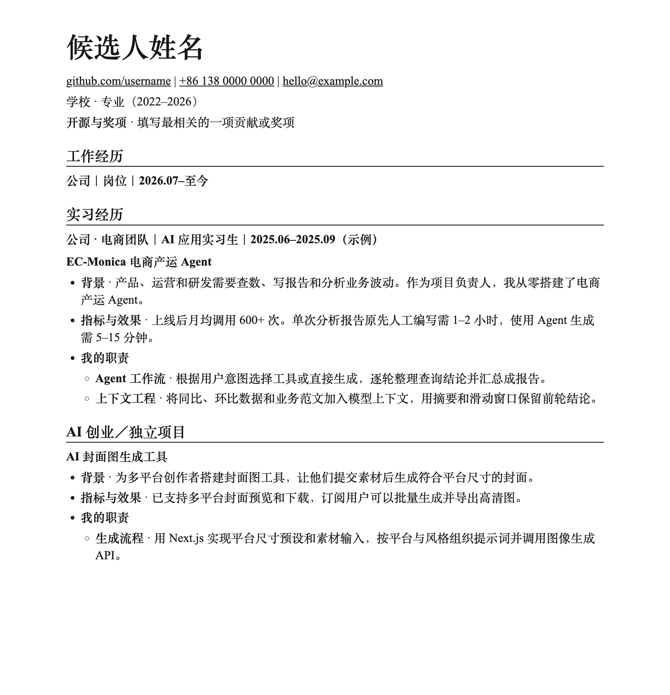

# OfferHunter｜用 STAR 法则写 AI 求职简历

简体中文 | [English](README.en.md)

[](LICENSE)

OfferHunter 是一个适用于 Claude、ChatGPT、Codex、Grok 等 AI 助手的开源简历技能，适合准备投递 AI 岗位的人。把旧简历、项目笔记和目标岗位的 JD 交给它，就可以从头写一份简历、调整栏目顺序，或重写某段经历。支持中文、英文和双语简历。

- **怎么写项目**：以 EC-Monica 电商 Agent 为例，展示如何交代业务背景、上线效果和本人负责的工作。[项目示例](skills/resume-engineering/references/examples.md)
- **不同岗位怎么选经历**：用 100 条 BOSS 直聘岗位样本，了解应用开发、模型训练、评测、AI 产品等岗位分别关注什么。[岗位参考](skills/resume-engineering/references/ai-roles.md)
- **整份简历怎么排**：从页首的联系方式和教育信息，到工作、实习和独立项目，附黑白单栏 HTML 和 LaTeX 模板。[简历结构](skills/resume-engineering/references/resume-structure.md)

[快速开始](#快速开始) · [STAR 写法](#用-star-写项目经历) · [HTML 模板](#html-简历模板) · [常见问题](#常见问题)

## 快速开始

### Claude Code、Codex、Grok CLI

在你的项目目录中执行：

```sh
git clone https://github.com/LofiSu/OfferHunter.git
```

按你使用的客户端选择一行。把整个技能目录复制过去，示例和模板也会一起安装。

```sh
# Claude Code
mkdir -p .claude/skills && cp -R OfferHunter/skills/resume-engineering .claude/skills/

# OpenAI Codex
mkdir -p .agents/skills && cp -R OfferHunter/skills/resume-engineering .agents/skills/

# Grok CLI
mkdir -p .grok/skills && cp -R OfferHunter/skills/resume-engineering .grok/skills/
```

在项目里开启新会话，请 Agent 使用 `resume-engineering`，并提供简历、项目笔记或目标 JD。其他支持 Agent Skills 的客户端可以把同一个目录放到它的技能目录。安装路径见[Claude Code 文档](https://code.claude.com/docs/en/skills)、[OpenAI 文档](https://developers.openai.com/api/reference/cli)及 [Grok CLI 文档](https://docs.x.ai/build/features/skills-plugins-marketplaces)。

### ChatGPT、Claude、Grok 网页端和其他聊天助手

上传或粘贴 [SKILL.md](skills/resume-engineering/SKILL.md)，再附上简历或项目笔记。有目标岗位时一并提供 JD。需要参考示例、结构或模板时，也把对应文件发给助手。可以直接这样说：

> 请按附件里的 resume-engineering 规则，为我写一份 AI 岗位简历。经历里的每个项目都用 STAR 整理，结果按现有材料写。

OpenAI API 集成也可以按官方文档把整个目录作为 Skill 使用。[OpenAI API Skills 指南](https://developers.openai.com/api/docs/guides/tools-skills)

## 用 STAR 写项目经历

简历里的每个项目都先拆成四部分，再写成正文。

- **S · 情境**：谁遇到了什么问题？
- **T · 任务**：项目要解决什么问题？你负责哪一部分？
- **A · 行动**：你具体做了什么？关键方案是怎么实现的？
- **R · 结果**：最后交付了什么？有哪些上线数据、使用反馈或验证结果？

正文可以沿用「背景与目标 → 指标与效果 → 我的职责」，也可以把四个要素压进一两条简历要点。没有量化指标时，用实际交付、采纳情况或已完成的验证来写结果。有待确认的事实放在稿外。

## 可以这样用

- 「按这份 AI 应用工程 JD 改写我的两段项目经历。每段保留最能体现工程取舍的两个要点。」
- 「把这份项目复盘写成可投递的一页简历。上线效果是团队数据，我个人负责的是流程编排。」
- 「审一遍这份简历。找出说不清归因的数字，给我可以直接替换的写法。」

默认给出可直接复制的简历正文。团队成果注明归属，个人职责写清自己具体做了什么。

查看 [EC-Monica 电商产运 Agent 的完整 STAR 改写](skills/resume-engineering/references/examples.md)。

## 整份简历与 LaTeX

可以从旧简历或项目笔记起草整份简历，也可以调整栏目顺序、压缩正文或只改一段经历。默认沿用「页首 → 工作经历 → 实习经历 → AI 创业／独立项目」的结构，按需呈现教育、开源和奖项。LaTeX 版采用简洁的黑白单栏排版。

[简历结构](skills/resume-engineering/references/resume-structure.md) · [LaTeX 模板](skills/resume-engineering/templates/resume.tex)

## HTML 简历模板



复制下面的代码，保存为 `resume.html`，在浏览器中打开。填写后可用浏览器的打印功能导出 A4 PDF。

<details>
<summary>展开并复制 HTML 源码</summary>

```html
<!doctype html>
<html lang="zh-CN">
<head>
  <meta charset="utf-8">
  <meta name="viewport" content="width=device-width, initial-scale=1">
  <title>候选人姓名</title>
  <style>
    @page { size: A4; margin: 17mm 19mm; }
    body {
      max-width: 172mm; margin: 2rem auto; padding: 0 1rem;
      color: #171717; background: #fff;
      font: 11pt/1.45 "Times New Roman", "Songti SC", "Noto Serif CJK SC", serif;
    }
    h1 { margin: 0 0 .2em; font-size: 25pt; }
    h2 { margin: 1em 0 .35em; border-bottom: 1px solid; font-size: 13pt; }
    h3, p { margin: .25em 0; }
    h3 { font-size: 11pt; }
    ul { margin: .25em 0; padding-inline-start: 1.2em; }
    li { margin: .2em 0; }
    a { color: inherit; }
    .contact { overflow-wrap: anywhere; }
    .resume-company-heading { margin: .4em 0; }
    .resume-project { margin: .4em 0 .6em; }
    .resume-project h4 { margin: .2em 0; font-size: 11pt; }
    ul ul { list-style-type: circle; }
    @media print {
      body { max-width: none; margin: 0; padding: 0; }
      h2, h3, h4 { break-after: avoid; }
      li { break-inside: avoid; }
    }
  </style>
</head>
<body>
  <header>
    <h1>候选人姓名</h1>
    <p class="contact"><a href="https://github.com/username">github.com/username</a> |
      <a href="tel:+8613800000000">+86 138 0000 0000</a> |
      <a href="mailto:hello@example.com">hello@example.com</a></p>
    <p>学校 · 专业（2022–2026）</p>
    <p><strong>开源与奖项</strong> · 填写最相关的一项贡献或奖项</p>
  </header>
  <main>
    <section>
      <h2>工作经历</h2>
      <h3 class="resume-company-heading">公司｜岗位｜2026.07–至今</h3>
      <!-- 有工作项目时，复制下方 resume-project。 -->
    </section>

    <section>
      <h2>实习经历</h2>
      <h3 class="resume-company-heading">公司 · 电商团队｜AI 应用实习生｜2025.06–2025.09（示例）</h3>
      <article class="resume-project">
        <h4>EC-Monica 电商产运 Agent</h4>
        <ul>
          <li><strong>背景</strong> · 产品、运营和研发需要查数、写报告和分析业务波动。作为项目负责人，我从零搭建了电商产运 Agent。</li>
          <li><strong>指标与效果</strong> · 上线后月均调用 600+ 次。单次分析报告原先人工编写需 1–2 小时，使用 Agent 生成需 5–15 分钟。</li>
          <li><strong>我的职责</strong>
            <ul>
            <li><strong>Agent 工作流</strong> · 根据用户意图选择工具或直接生成，逐轮整理查询结论并汇总成报告。</li>
            <li><strong>上下文工程</strong> · 将同比、环比数据和业务范文加入模型上下文，用摘要和滑动窗口保留前轮结论。</li>
            </ul>
          </li>
        </ul>
      </article>
    </section>

    <section>
      <h2>AI 创业／独立项目</h2>
      <article class="resume-project">
        <h4>AI 封面图生成工具</h4>
        <ul>
          <li><strong>背景</strong> · 为多平台创作者搭建封面图工具，让他们提交素材后生成符合平台尺寸的封面。</li>
          <li><strong>指标与效果</strong> · 已支持多平台封面预览和下载，订阅用户可以批量生成并导出高清图。</li>
          <li><strong>我的职责</strong>
            <ul>
            <li><strong>生成流程</strong> · 用 Next.js 实现平台尺寸预设和素材输入，按平台与风格组织提示词并调用图像生成 API。</li>
            </ul>
          </li>
        </ul>
      </article>
    </section>
  </main>
</body>
</html>
```

</details>

## 常见问题

### 没有目标 JD，能先写一整份 AI 简历吗？

可以。先用旧简历或项目笔记起草，优先写职责和结果最清楚的经历。拿到岗位 JD 后，再按该岗位的实际工作重排和精简。

### STAR 法则怎么用在一页简历里？

把情境和任务压成一句话，用动作写清个人贡献，再接上能核对的结果。团队数据写清归属。没有量化数据时，可以写已上线能力、实际采纳或验证发现。

### HTML 或 LaTeX 简历如何导出 PDF？

HTML 可用浏览器的打印菜单导出 A4 PDF。LaTeX 源文件可用 XeLaTeX 编译。两份模板都使用单栏布局，适合突出内容和阅读顺序。

### BOSS 直聘岗位索引是什么？

索引来自公开招聘列表，保留职位名、可见 JD 关键词、STAR 取材提示和来源。采集日期和访问限制见[岗位参考](skills/resume-engineering/references/ai-roles.md)。

## 贡献

欢迎通过 [Issues](https://github.com/LofiSu/OfferHunter/issues) 提交可追溯的公开 JD、脱敏案例或模板改进。如果 OfferHunter 帮你把一段经历写得更清楚，欢迎在 GitHub 点一颗 Star。

## 许可

[MIT](LICENSE)
