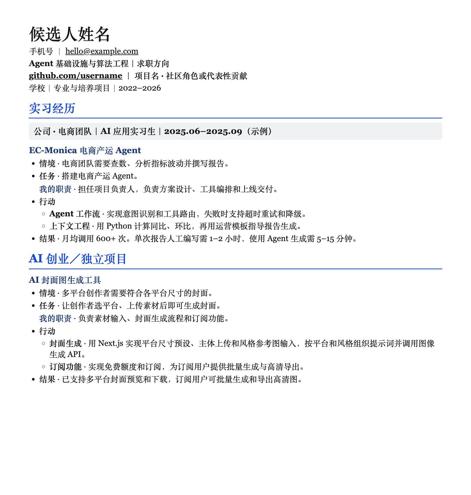

# OfferHunter｜用 STAR 法则写 AI 求职简历

简体中文 | [English](README.en.md)

[](LICENSE)

OfferHunter 是一个适用于 Claude、ChatGPT、Codex、Grok 等 AI 助手的开源简历技能，适合准备投递 AI 岗位的人。把旧简历、项目笔记和目标岗位的 JD 交给它，就可以从头写一份简历、调整栏目顺序，或重写某段经历。支持中文、英文和双语简历。

- **怎么写项目**：以 EC-Monica 电商 Agent 为例，展示如何交代业务背景、上线效果和本人负责的工作。[项目示例](skills/resume-engineering/references/examples.md)
- **不同岗位怎么选经历**：用 100 条 BOSS 直聘岗位样本，了解应用开发、模型训练、评测、AI 产品等岗位分别关注什么。[岗位参考](skills/resume-engineering/references/ai-roles.md)
- **整份简历怎么排**：从页首的联系方式和教育信息，到工作、实习和独立项目，附黑白单栏 HTML 和 LaTeX 模板。[简历结构](skills/resume-engineering/references/resume-structure.md)

[快速开始](#快速开始) · [STAR 写法](#用-star-写项目经历) · [HTML 模板](#html-简历模板) · [常见问题](#常见问题)

## 快速开始

在项目目录里克隆仓库，再按客户端选一条安装命令。

```sh
git clone https://github.com/LofiSu/OfferHunter.git
```

```sh
# Claude Code
mkdir -p .claude/skills && cp -R OfferHunter/skills/resume-engineering .claude/skills/
# Codex
mkdir -p .agents/skills && cp -R OfferHunter/skills/resume-engineering .agents/skills/
# Grok CLI
mkdir -p .grok/skills && cp -R OfferHunter/skills/resume-engineering .grok/skills/
```

开启新会话，请助手使用 `resume-engineering`。

**ChatGPT、Claude、Grok 网页端**：上传或粘贴 [SKILL.md](skills/resume-engineering/SKILL.md)，附上简历或项目笔记。有目标 JD 时一并提供。使用 OpenAI API 可参考[官方指南](https://developers.openai.com/api/docs/guides/tools-skills)。

## 用 STAR 写项目经历

简历里的每个项目都先拆成四部分，再写成正文。

- **S · 情境**：谁遇到了什么问题？
- **T · 任务**：项目要解决什么问题？用「我的职责」交代你负责的模块和交付范围。
- **A · 行动**：你具体做了什么？关键方案是怎么实现的？
- **R · 结果**：最后交付了什么？有哪些上线数据、使用反馈或验证结果？

正文里的每个项目都按「情境、任务、行动、结果」分四行写，一页简历也采用这个顺序。没有量化指标时，用实际交付、采纳情况或已完成的验证来写结果。有待确认的事实放在稿外。

## 可以这样用

- 「按这份 AI 应用工程 JD 改写我的两段项目经历。每段保留最能体现工程取舍的两个要点。」
- 「把这份项目复盘写成可投递的一页简历。上线效果是团队数据，我个人负责的是流程编排。」
- 「审一遍这份简历。找出说不清归因的数字，给我可以直接替换的写法。」

默认给出可直接复制的简历正文。团队成果注明归属，个人职责写清自己具体做了什么。

查看 [EC-Monica 电商产运 Agent 的完整 STAR 改写](skills/resume-engineering/references/examples.md)。

## 整份简历与 LaTeX

可以从旧简历或项目笔记起草整份简历，也可以调整栏目顺序、压缩正文或只改一段经历。默认沿用「页首 → 工作经历 → 实习经历 → AI 创业／独立项目」的结构，按需呈现教育、开源和奖项。LaTeX 版采用简洁的黑白单栏排版。

[简历结构](skills/resume-engineering/references/resume-structure.md) · [LaTeX 模板](skills/resume-engineering/templates/resume.tex)

## HTML 简历模板



示例从实习经历开始。有正式工作经历时，可复制公司和项目的结构，在实习前加上「工作经历」。

复制下面的代码，保存为 `resume.html`，在浏览器中打开。填写后可用浏览器的打印功能导出 A4 PDF。

<details>
<summary>展开并复制 HTML 源码</summary>

```html
<!doctype html>
<html lang="zh-CN">
<head>
  <meta charset="utf-8">
  <meta name="viewport" content="width=device-width, initial-scale=1">
  <title>候选人姓名</title>
  <style>
    @page { size: A4; margin: 11mm; }
    * { box-sizing: border-box; }
    body {
      max-width: 210mm; margin: 0 auto; padding: 11mm;
      background: #fff; color: #161616;
      font: 10.5pt/1.38 Georgia, "Songti SC", "Noto Serif CJK SC", serif;
    }
    h1 { font-size: 21pt; line-height: 1.15; margin: 0 0 .15em; }
    header p { margin: .12em 0; }
    a { color: inherit; overflow-wrap: anywhere; }
    .profile, .open-source { font-weight: 700; }
    .section-title {
      color: #174add; border-bottom: 1.5px solid #315eed;
      font-size: 15pt; margin: .55em 0 .35em; padding-bottom: .16em;
    }
    .employer {
      background: #f0f1f3; border-radius: 4px;
      margin: .45em 0 .3em; padding: .32em .55em; font-size: 11pt;
    }
    .project-title { color: #193677; margin: .55em 0 .15em; font-size: 11pt; }
    .star { margin: 0; padding-inline-start: 1.25em; }
    .star > li { margin: .16em 0; }
    .star ul { list-style: circle; margin: .1em 0 0; padding-inline-start: 1.25em; }
    .responsibility { margin: .2em 0 .18em; }
    .responsibility strong { color: #193677; }
    .star-action li { margin: .12em 0; }
    @media print {
      body { max-width: none; margin: 0; padding: 0; }
      h2, h3, h4 { break-after: avoid; }
      li { break-inside: avoid; }
      .employer { print-color-adjust: exact; }
    }
  </style>
</head>
<body>
  <header>
    <h1>候选人姓名</h1>
    <p>手机号 ｜ <a href="mailto:hello@example.com">hello@example.com</a></p>
    <p class="profile">Agent 基础设施与算法工程｜求职方向</p>
    <p class="open-source"><a href="https://github.com/username">github.com/username</a> ｜ 项目名 · 社区角色或代表性贡献</p>
    <p>学校｜专业与培养项目｜2022–2026</p>
  </header>
  <main>
    <section>
      <h2 class="section-title">实习经历</h2>
      <h3 class="employer">公司 · 电商团队｜AI 应用实习生｜2025.06–2025.09（示例）</h3>
      <article class="resume-project">
        <h4 class="project-title">EC-Monica 电商产运 Agent</h4>
        <ul class="star">
          <li><strong>情境</strong> · 电商团队需要查数、分析指标波动并撰写报告。</li>
          <li><strong>任务</strong> · 搭建电商产运 Agent。
            <div class="responsibility"><strong>我的职责</strong> · 担任项目负责人，负责方案设计、工具编排和上线交付。</div>
          </li>
          <li class="star-action"><strong>行动</strong>
            <ul>
              <li><strong>Agent 工作流</strong> · 实现意图识别和工具路由，失败时支持超时重试和降级。</li>
              <li><strong>上下文工程</strong> · 用 Python 计算同比、环比，再用运营模板指导报告生成。</li>
            </ul>
          </li>
          <li><strong>结果</strong> · 月均调用 600+ 次。单次报告人工编写需 1–2 小时，使用 Agent 生成需 5–15 分钟。</li>
        </ul>
      </article>
    </section>

    <section>
      <h2 class="section-title">AI 创业／独立项目</h2>
      <article class="resume-project">
        <h4 class="project-title">AI 封面图生成工具</h4>
        <ul class="star">
          <li><strong>情境</strong> · 多平台创作者需要符合各平台尺寸的封面。</li>
          <li><strong>任务</strong> · 让创作者选平台、上传素材后即可生成封面。
            <div class="responsibility"><strong>我的职责</strong> · 负责素材输入、封面生成流程和订阅功能。</div>
          </li>
          <li class="star-action"><strong>行动</strong>
            <ul>
              <li><strong>封面生成</strong> · 用 Next.js 实现平台尺寸预设、主体上传和风格参考图输入，按平台和风格组织提示词并调用图像生成 API。</li>
              <li><strong>订阅功能</strong> · 实现免费额度和订阅，为订阅用户提供批量生成与高清导出。</li>
            </ul>
          </li>
          <li><strong>结果</strong> · 已支持多平台封面预览和下载，订阅用户可批量生成和导出高清图。</li>
        </ul>
      </article>
    </section>
  </main>
</body>
</html>
```

</details>

## 常见问题

### 没有目标 JD，能先写一整份 AI 简历吗？

可以。先用旧简历或项目笔记起草，优先写职责和结果最清楚的经历。拿到岗位 JD 后，再按该岗位的实际工作重排和精简。

### STAR 法则怎么用在一页简历里？

每个项目写四行，每行只留最需要读者知道的信息。团队数据写清归属。没有量化数据时，可以写已上线能力、实际采纳或验证发现。

### HTML 或 LaTeX 简历如何导出 PDF？

HTML 可用浏览器的打印菜单导出 A4 PDF。LaTeX 源文件可用 XeLaTeX 编译。两份模板都使用单栏布局，适合突出内容和阅读顺序。

### BOSS 直聘岗位索引是什么？

索引来自公开招聘列表，保留职位名、可见 JD 关键词、STAR 取材提示和来源。采集日期和访问限制见[岗位参考](skills/resume-engineering/references/ai-roles.md)。

## 贡献

欢迎通过 [Issues](https://github.com/LofiSu/OfferHunter/issues) 提交可追溯的公开 JD、脱敏案例或模板改进。如果 OfferHunter 帮你把一段经历写得更清楚，欢迎在 GitHub 点一颗 Star。

## 许可

[MIT](LICENSE)
